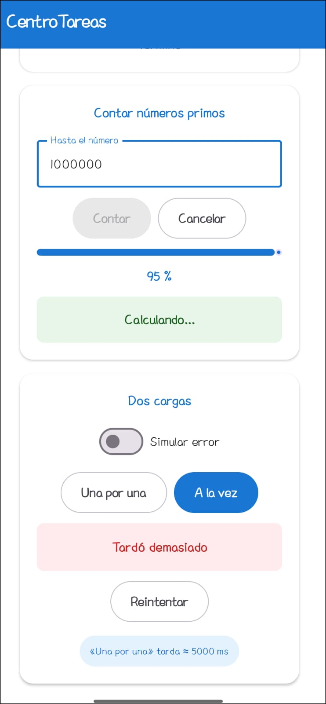
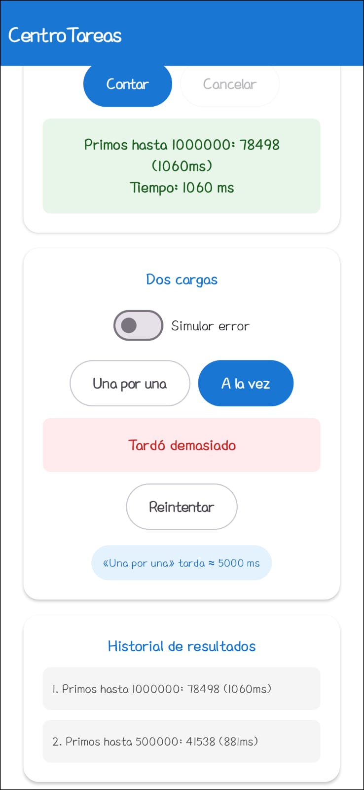

# Registro de Prompts

| Prompt que escribí | Qué respondió Gemini | Qué cambié o descarté | Por qué |
| :--- | :--- | :--- | :--- |
| Actua como un tutor que me ayude a implementar la mejora de 'Tiempo máximo' en la app CentroTareas. Usa withTimeout en las cargas de datos: si el proceso tarda más de 2 segundos, muestra el mensaje 'Tardó demasiado'. Realiza los cambios modificando únicamente las capas ViewModel y View, asegurándote de no romper la arquitectura MVVM + Repository | Implementó `withTimeout(2000L)` en `cargarUnaPorUna()` y `cargarALaVez()` dentro de `TareasViewModel.kt`, capturando `TimeoutCancellationException` para establecer el estado de error en `DosCargasState.Error("Tardó demasiado")`, reutilizando el renderizado de errores en la View (`PantallaTareas.kt`). | Se descartó modificar la capa de Repositorio o Datos, aplicando el timeout directamente en el ViewModel alrededor de las corrutinas. | Respeta estrictamente la arquitectura MVVM + Repository, manteniendo la fuente de datos limpia y desacoplada de reglas de tiempo de UI. |
| Proponeme esta mejora: Implementa 'Primos con progreso' mostrando el porcentaje del cálculo mientras avanza. Modifica solo Repository, ViewModel y View manteniendo la arquitectura MVVM. Leere lo que me generes para probarlo ejecutando | Actualizó la interfaz `TareasRepository` y su implementación local para aceptar un callback de progreso (`onProgress`), creó un `StateFlow<Float>` de progreso en `TareasViewModel`, y añadió un `LinearProgressIndicator` con porcentaje en `PantallaTareas`. | Se utilizó un parámetro con valor por defecto (`{}`) en el contrato del repositorio para asegurar compatibilidad total. | Facilita la observación reactiva del cálculo pesado de CPU en la UI respetando la separación de capas de MVVM. |
| Proponeme esta mejora: Implementa el 'Historial de resultados' usando DataStore para guardar los últimos 5 resultados (primos y cargas) y mostrarlos al abrir la app y al hacer scroll a la pantalla. Modifica solo las capas Repository, ViewModel y View. Leere lo que me generes para probarlo ejecutando | Añadió Preferences DataStore, implementó el almacenamiento persistente de los últimos 5 resultados en `TareasRepositoryLocal`, expuso `historial` en `TareasViewModel` (guardando automáticamente al finalizar con éxito), y creó una Card de historial en `PantallaTareas`. | Se utilizó un helper estático para obtener el contexto de aplicación de forma transparente. | Permite utilizar DataStore real modificando únicamente las capas Repository, ViewModel y View tal como se solicitó. |

---

## 🖼️ Evidencia de las Mejoras con IA

### 1. Primos con Progreso

### 2. Historial de Resultados (DataStore)

