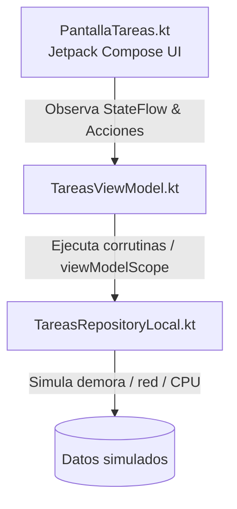
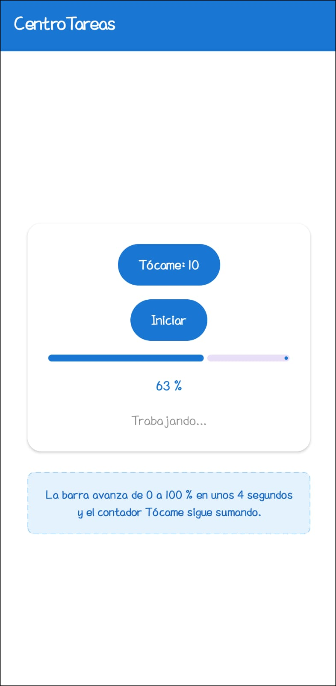
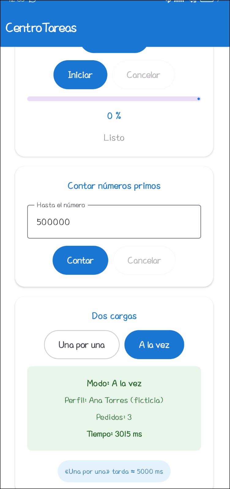
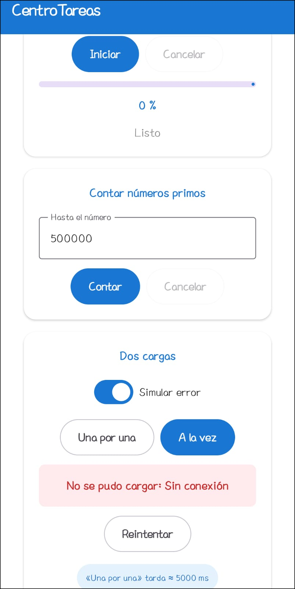

# CentroTareas

## 📱 Descripción del Proyecto
**CentroTareas** es una aplicación Android desarrollada con **Jetpack Compose** y arquitectura **MVVM** (Model-View-ViewModel) que demuestra el dominio avanzado de **Corrutinas en Kotlin**, manejo de estados reactivos con `StateFlow`, concurrencia estructurada (`async` vs secuencial), cancelación cooperativa de tareas pesadas de CPU, y robustos estados de error y reintento.

---

## 🗂️ Árbol de Paquetes
```text
com.carbajal.centrotareas/
├── data/
│   ├── TareasRepository.kt
│   └── TareasRepositoryLocal.kt
├── model/
│   └── Estados.kt
├── ui/
│   ├── PantallaTareas.kt
│   └── theme/
│       ├── Color.kt
│       ├── Theme.kt
│       └── Type.kt
├── viewmodel/
│   ├── TareasViewModel.kt
│   └── TareasViewModelFactory.kt
└── MainActivity.kt
```

---

## 🏛️ Diagrama Arquitectural MVVM


---

## 📝 Observaciones por Paso

### Paso 1: Tarea Bloqueante (Hilo Principal)
- **¿Qué pasa con la pantalla?**: La pantalla se congela por completo durante 4 segundos (no responde a eventos táctiles ni redibuja).
- **Evidencia Visual (Congelada / Tarea Inicial)**:
  

---

### Paso 2 y 3: Tarea en Segundo Plano y Progreso en Tiempo Real
- **Comportamiento**: Al usar `viewModelScope.launch` junto con `withContext(Dispatchers.Default)`, la tarea corre en segundo plano sin bloquear el hilo principal. El `LinearProgressIndicator` muestra el avance fluido mientras el contador sigue respondiendo.
- **Evidencia Visual (Progreso de Carga)**:
  

---

### Paso 4: Cancelación y Control de Concurrencia
- **Comportamiento**: Se administra la referencia al `Job` y un estado booleano `corriendo`. Al pulsar **Cancelar**, se detiene la corrutina de forma cooperativa y se actualiza el mensaje.
- **Evidencia Visual (Tarea Larga / Ejecución / Cancelación)**:
  

---

### Paso 5: Cálculo de Números Primos en Segundo Plano
- **Comportamiento**: Cálculo intensivo de CPU ejecutado en `Dispatchers.Default` con `ensureActive()` para cancelación cooperativa.
- **Evidencia Visual (Números Primos)**:
  

---

### Paso 6 y 7: Dos Cargas (Concurrencia: Una por una vs A la vez) & Estados de Error y Reintento
- **Comportamiento**:
  - **Una por una**: Ejecución secuencial (~5000 ms).
  - **A la vez (`async`)**: Ejecución paralela (~3000 ms).
  - **Simular Error**: Si está activado, la carga falla mostrando un recuadro de error y permitiendo pulsar **Reintentar** de forma segura.
- **Evidencia Visual (Dos Cargas & Error Simulado)**:
  
  

---

## 🤔 Preguntas para Pensar ("Para pensar")

1. **¿Por qué no se veía `Trabajando...` en el Paso 1?**
   - Porque `Thread.sleep(4000)` bloquea por completo el hilo principal (UI Thread). Aunque el estado cambie a "Trabajando...", Jetpack Compose no puede procesar la recomposición ni redibujar la interfaz gráfica porque el hilo encargado de pintar en pantalla está bloqueado en espera activa.

2. **¿Qué diferencia hay entre `Thread.sleep` y `delay`?**
   - `Thread.sleep` bloquea físicamente el hilo actual (ej. el hilo principal UI), impidiendo cualquier otra operación o renderizado en ese hilo hasta que transcurra el tiempo. `delay` es una función suspensión no bloqueante de corrutinas (`suspend`), que suspende la ejecución de la corrutina liberando el hilo subyacente para que pueda atender otros eventos (como UI o eventos táctiles) y reanuda la corrutina cuando el tiempo expira.

3. **¿Por qué `Dispatchers.Default` para los primos y `Dispatchers.IO` para la red?**
   - `Dispatchers.Default` está optimizado para operaciones intensivas de CPU (cálculos pesados como contar números primos, procesamiento de datos, etc.) utilizando un pool de hilos limitado al número de núcleos del procesador. `Dispatchers.IO` (o operaciones de red/base de datos) está optimizado para operaciones de entrada/salida (I/O) que esperan respuestas de red, disco o bases de datos, con un pool de hilos más amplio para evitar bloqueos por latencia de red.

4. **¿Qué pasaría con la corrutina si el usuario cierra la pantalla? ¿Qué papel cumple `viewModelScope`?**
   - Si el usuario cierra la pantalla (o el ViewModel es destruido), `viewModelScope` cancela automáticamente todas las corrutinas iniciadas dentro de él (`onCleared()`). Esto previene fugas de memoria (*memory leaks*), consumo innecesario de CPU/batería y crashes por intentar actualizar estados en vistas que ya no existen.

5. **¿Por qué `async` tarda 3 s y no 5 s? ¿Qué pasa si una de las dos cargas falla?**
   - `async` lanza las operaciones en paralelo (concurrencia estructurada con `coroutineScope`). Al ejecutarse simultáneamente `cargarPerfil()` (2s) y `cargarPedidos()` (3s), el tiempo total corresponde al de la tarea más larga (~3s) en lugar de la suma secuencial (2s + 3s = 5s). Si una de las corrutinas dentro de `async` falla (lanza una excepción), la excepción se propaga al bloqueador `coroutineScope`, cancelando las demás corrutinas hermanas y entrando al bloque `catch` para manejar el estado de error de forma segura sin cerrar la app.
