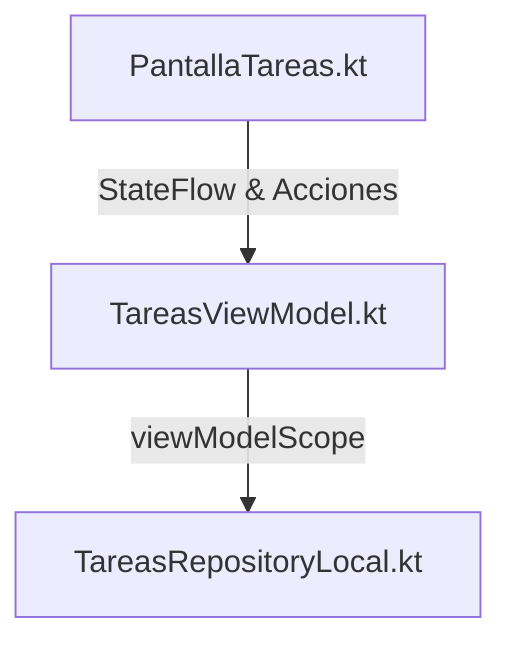
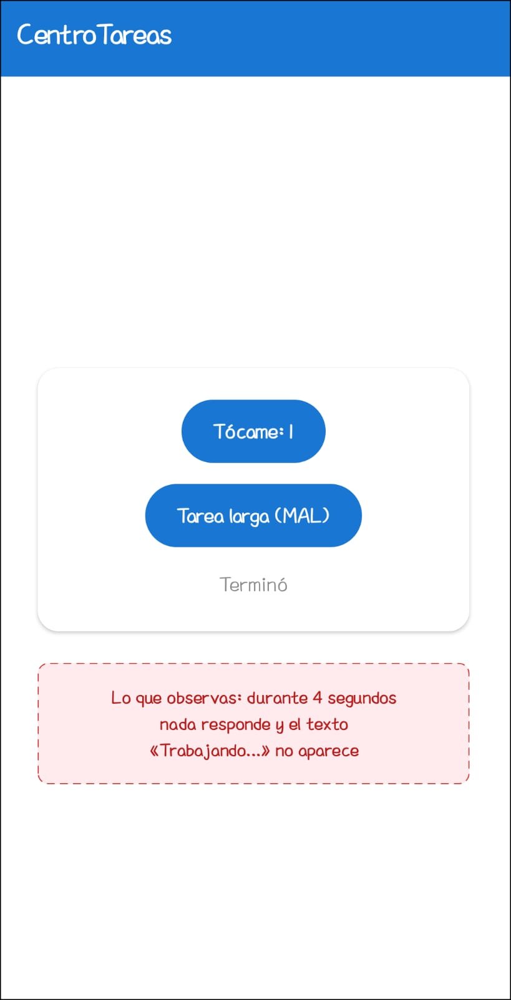
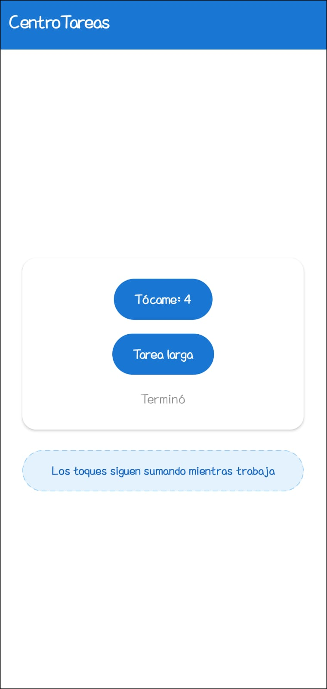
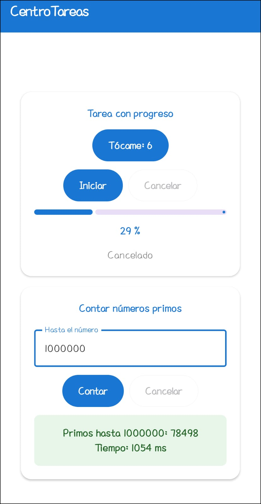
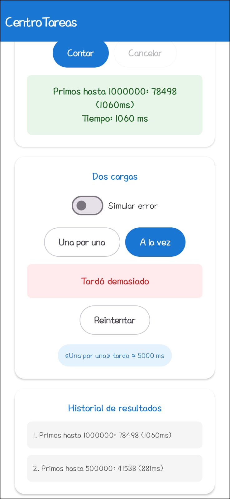

# CentroTareas 📱⚡

Aplicación Android desarrollada en **Jetpack Compose** y arquitectura **MVVM** que demuestra el uso avanzado de **Corrutinas en Kotlin**, concurrencia (`async` vs secuencial), cancelación cooperativa, cálculos pesados de CPU y manejo de estados.

---

## 🗂️ Estructura del Proyecto
```text
com.carbajal.centrotareas/
├── data/       # Repositorios de datos y simulación
├── model/      # Estados y modelos de datos
├── ui/         # Pantallas (Jetpack Compose) y Tema
└── viewmodel/  # Lógica de negocio (ViewModel)
```

---

## 🏛️ Diagrama MVVM


---

## 📸 Evidencias y Pasos del Reto

| Paso / Característica | Vista Previa | Descripción y Comportamiento |
| :--- | :---: | :--- |
| **1. Tarea Bloqueante (MAL)** |  | `Thread.sleep(4000)` bloquea el hilo principal (UI Thread), congelando la pantalla y evitando que se renderice el texto de carga. |
| **2 & 3. Segundo Plano y Progreso** |  | Uso de `Dispatchers.Default` y `delay()`. La barra avanza de 0% a 100% mientras la UI sigue respondiendo y sumando al contador. |
| **4. Cancelación de Tarea** |  | El `Job` se cancela de forma cooperativa al pulsar **Cancelar**, deteniendo el progreso y mostrando el estado "Cancelado". |
| **5. Números Primos (CPU)** |  | Cálculo intensivo de números primos en segundo plano con `ensureActive()` para cancelación segura y medición de tiempo en ms. |
| **6. Dos Cargas en Paralelo** |  | Comparación de carga secuencial (~5s) vs. en paralelo con `async` (`coroutineScope`) (~3s). |
| **7. Error Simulado** |  | Manejo robusto de excepciones (ej. `IOException("Sin conexión")`) con estados de error y reintento. |
| **Mejoras IA / Historial** |  | Funcionalidades adicionales de historial y procesamiento optimizado. |

---

## 🤔 Conceptos Clave (Preguntas Frecuentes)

1. **¿Por qué no se veía "Trabajando..." en el Paso 1?**
   - Porque `Thread.sleep` bloquea el hilo principal, impidiendo que Compose procese recomposiciones visuales.
2. **Diferencia entre `Thread.sleep` y `delay`**
   - `Thread.sleep` bloquea el hilo por completo. `delay` suspende la corrutina sin bloquear el hilo, permitiendo que la UI siga respondiendo.
3. **¿`Dispatchers.Default` vs `Dispatchers.IO`?**
   - `Default` se usa para cálculos intensivos de CPU (números primos). `IO` se usa para operaciones de red o disco.
4. **¿Qué hace `viewModelScope` al cerrar la pantalla?**
   - Cancela automáticamente todas las corrutinas activas, previniendo fugas de memoria y bloqueos.
5. **¿Por qué `async` tarda 3s y qué pasa si falla?**
   - Ejecuta tareas en paralelo (el tiempo de la tarea más larga, no la suma). Si una falla, propaga la excepción y cancela las hermanas de forma segura mediante el bloque `try/catch`.
