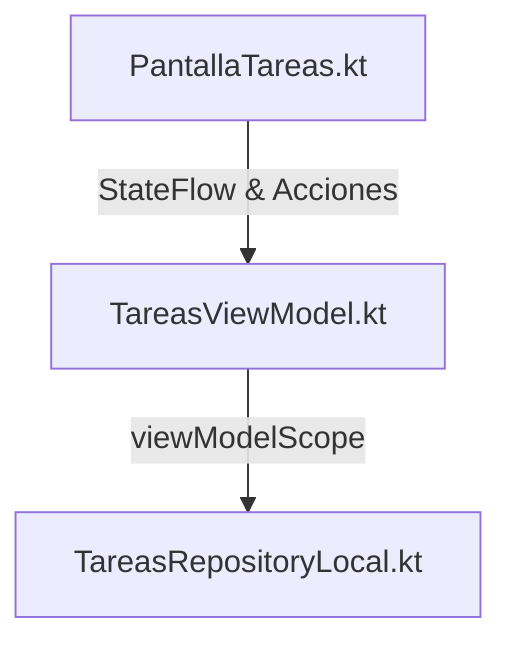

# CentroTareas

Aplicación Android en **Jetpack Compose** y arquitectura **MVVM** que demuestra el uso de **Corrutinas en Kotlin**, concurrencia (`async` vs secuencial), cancelación cooperativa y manejo de estados de error/reintento.

---

## 🗂️ Estructura del Proyecto
```text
com.carbajal.centrotareas/
├── data/       # Repositorios de datos y simulación
├── model/      # Estados y modelos de datos
├── ui/         # Pantallas (Jetpack Compose) y Tema
└── viewmodel/  # Lógica de negocio (ViewModel)
```

---

## 🏛️ Diagrama MVVM


---

## 📝 Observaciones y Evidencias

### 1. Tarea Bloqueante (Paso 1)
- **¿Qué pasa?**: `Thread.sleep(4000)` bloquea el hilo principal (UI Thread), congelando la pantalla y evitando que se pinte "Trabajando...".
- 

### 2 & 3. Segundo Plano y Progreso (Pasos 2-3)
- **Comportamiento**: Con `Dispatchers.Default` y `delay()`, la UI permanece fluida mientras el indicador avanza.
- 

### 4. Cancelación (Paso 4)
- **Comportamiento**: El `Job` se cancela de forma cooperativa al pulsar **Cancelar**.
- 

### 5. Números Primos (Paso 5)
- **Comportamiento**: Cálculo pesado de CPU en segundo plano con `ensureActive()`.
- 

### 6 & 7. Dos Cargas y Errores (Pasos 6-7)
- **Comportamiento**: Compara secuencial (~5s) vs paralelo `async` (~3s). Permite simular errores y reintentar sin cerrar la app.
- 
- 

---

## 🤔 Para Pensar (Conceptos Clave)

1. **¿Por qué no se veía "Trabajando..." en el Paso 1?**
   - Porque `Thread.sleep` bloquea el hilo principal, impidiendo que Compose procese recomposiciones visuales.

2. **Diferencia entre `Thread.sleep` y `delay`**
   - `Thread.sleep` bloquea el hilo por completo. `delay` suspende la corrutina sin bloquear el hilo, permitiendo que la UI siga respondiendo.

3. **¿`Dispatchers.Default` vs `Dispatchers.IO`?**
   - `Default` se usa para cálculos intensivos de CPU (números primos). `IO` se usa para operaciones de red o disco.

4. **¿Qué hace `viewModelScope` al cerrar la pantalla?**
   - Cancela automáticamente todas las corrutinas activas, previniendo fugas de memoria y bloqueos.

5. **¿Por qué `async` tarda 3s y qué pasa si falla?**
   - Ejecuta tareas en paralelo (el tiempo de la tarea más larga, no la suma). Si una falla, propaga la excepción y cancela las hermanas de forma segura mediante el bloque `try/catch`.
